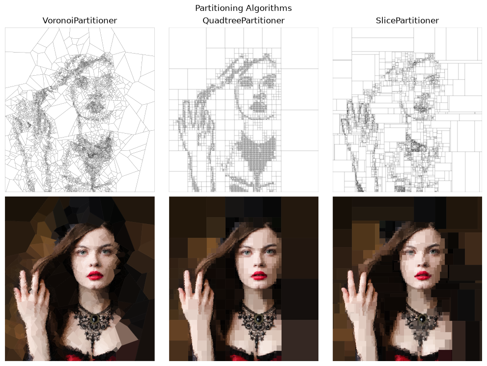
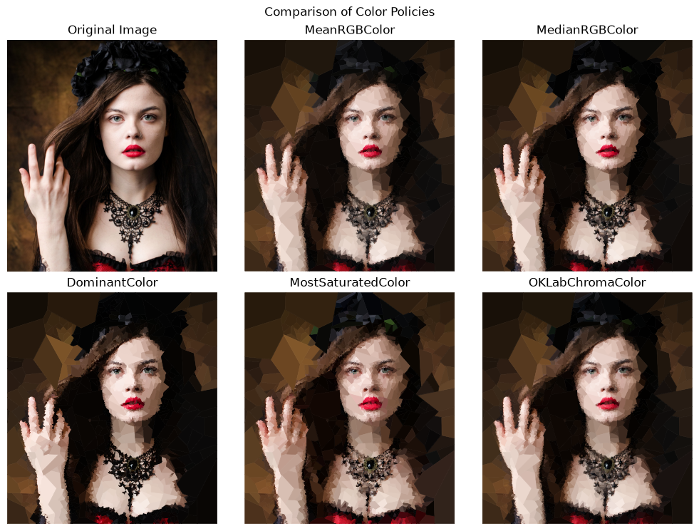

# TILEs

Python toolkit for decomposing images into collections of colored polygonal
tiles. It provides several partitioning strategies, including quadtrees, Voronoi trees,
recursive slicing, and random polygons. Tile boundaries can be guided by local image
statistics, a heightmap, or custom stopping and color policies.

The resulting tiles can be rendered as images or plotted as vector-like polygon
collections.

## Quick start

```python
from tiles import load_images, save_tileset
from tiles.partitioners.quadtree import QuadtreePartitioner
from tiles.recursion import grow_tree
from tiles.stopping_policies import UniformColorStop
from tiles.color_policies import MeanRGBColor

context = load_images("input.jpg")
tile_set = grow_tree(
    context,
    partitioner=QuadtreePartitioner(),
    stop_policy=UniformColorStop(standard_deviation=30),
    color_policy=MeanRGBColor(),
    seed=42,
)
save_tileset(tile_set, "tiles.png", width=8)
```

The same `TileSet` can be rendered as a Matplotlib figure with
`tileset_to_figure`, or saved directly with `save_tileset`.

## Color policies

The `color_policy` argument controls the representative color assigned to each tile.
Without one, TILEs uses the region's mean RGB color.

## Stop policies

The `stop_policy` determines when a region should stop being subdivided. For example,
`MaxLevelStop` limits recursion depth, while `UniformColorStop` stops when a region's
color variation is below a threshold. Other built-in policies can use heightmap contrast,
heightmap range, target tile size, perceptual uniformity, or stochastic stopping. Policies
can also be combined with `AllOf` and `AnyOf`.

```python
from tiles.stopping_policies import AnyOf, MaxLevelStop, UniformColorStop

stop_policy = AnyOf(
    UniformColorStop(standard_deviation=30),
    MaxLevelStop(max_level=6),
)
```

## Examples

Model: [@maleficent_model](https://www.instagram.com/maleficent_model/)

### Partitioning strategies



### Color policies



## Performance notes

- Quadtree and recursive slicing compute region statistics in constant time from summed-area tables
  (`tiles.integral`). The tables cost about 40 bytes per pixel and are skipped above
  `tiles.integral.INTEGRAL_MAX_PIXELS` (4 million pixels); results are identical either way, only slower.
- Each region's visible pixels and polygon mask are computed once and shared by the stop policy, the colour policy and the tile image.
- Tile images are rendered when accessed, not stored. `Tile.image` re-renders on every access,
  which keeps large tile sets light in memory.

See a [Notebook](https://github.com/Sylvain-Rama/TILEs/blob/main/src/scripts/tiles_example.ipynb) for more information.

This was originally written to use with [PILes](https://github.com/Sylvain-Rama/PILes)
